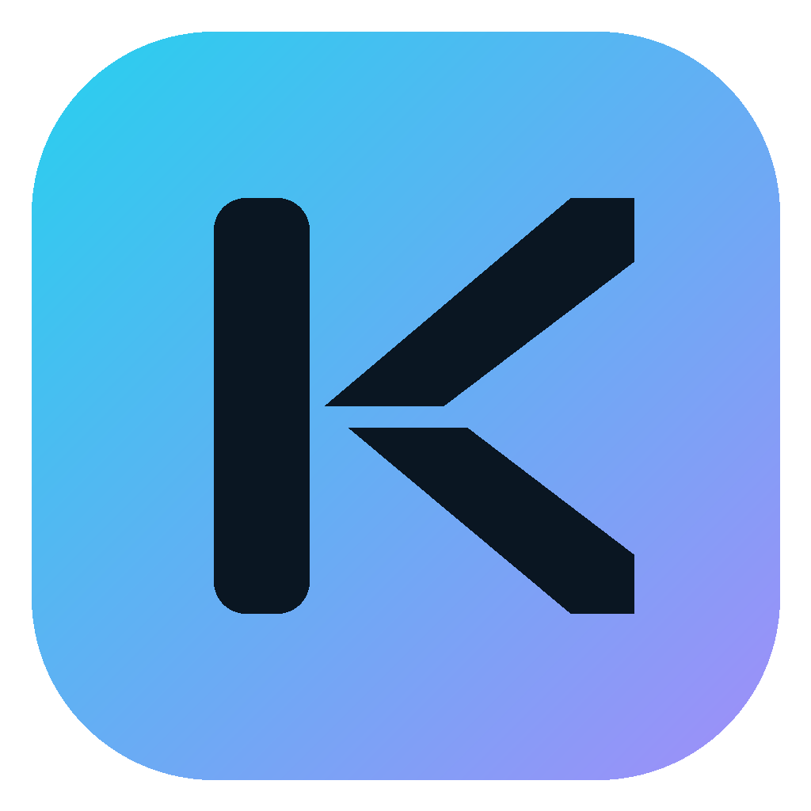
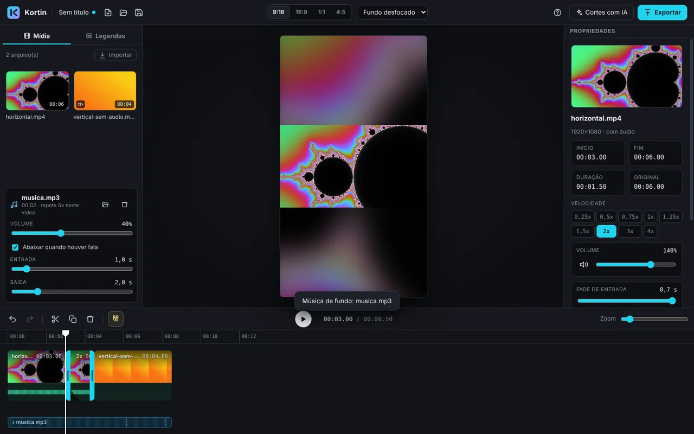
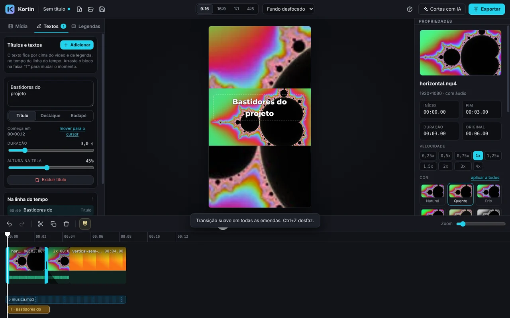
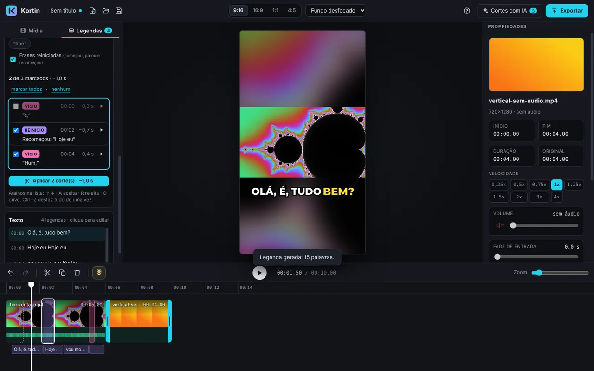
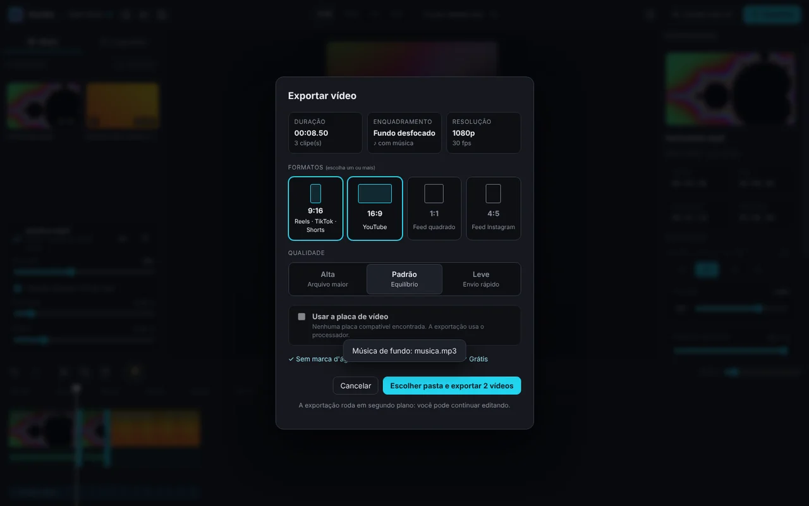
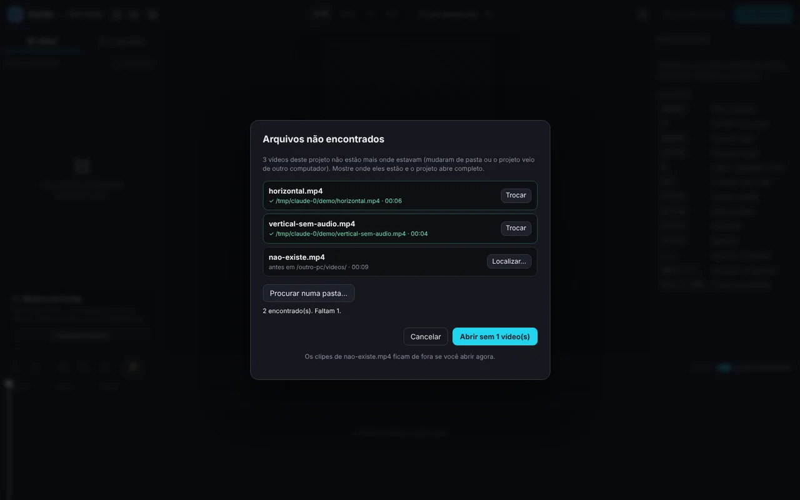

<div align="center">



# Kortin

**Editor de vídeo para quem produz conteúdo curto — sem pegadinha.**<br/>
Sem anúncio, sem marca d'água, sem assinatura pra salvar o seu próprio vídeo.<br/>
Legenda automática e cortes com IA processados no seu computador — o vídeo não sai da sua máquina.

[](https://github.com/thiagolynch/kortin/releases/latest)
[](https://github.com/thiagolynch/kortin/actions)


**[Baixar o instalador para Windows](https://github.com/thiagolynch/kortin/releases/latest/download/Kortin-Instalador.exe)** · [versão portátil](https://github.com/thiagolynch/kortin/releases/latest/download/Kortin-Portatil.exe) · [Novidades](CHANGELOG.md) · [Arquitetura](docs/ARQUITETURA.md)



</div>

---

## Por que o Kortin existe

A maioria dos editores de vídeo curto hoje trava alguma coisa importante atrás de assinatura: exportar sem marca d'água, usar a legenda automática depois de um certo limite, ou simplesmente manter seu vídeo na nuvem de alguém. O Kortin nasceu pra não fazer nenhuma dessas três coisas.

- Nunca coloca marca d'água no seu vídeo.
- Exportar é sempre grátis, em qualquer formato, na qualidade máxima.
- Vídeo, legenda e cortes com IA são processados no seu PC — nada sobe pra nuvem.
- Funciona offline, sem limite de uso nem créditos pra gastar. Só o primeiro uso da legenda automática pede internet, pra baixar o modelo de IA (de 148 a 574 MB, uma vez só).
- Sem cadastro, sem anúncio.

## O que já dá pra fazer

**Edição.** Importa arrastando ou pelo botão (MP4, MOV, MKV, WEBM, AVI…). A linha do tempo tem miniatura, onda sonora, zoom (`Ctrl` + roda) e um ímã que gruda nas emendas pra evitar buraco ou sobreposição. Corta pelas alças, divide no cursor (`S`), duplica, exclui, reordena arrastando. Velocidade de 0,25x a 4x sem o áudio ficar esquisito, volume até 200%, fades de entrada e saída — e desfazer/refazer de tudo, cada arrasto como um passo só. Formatos 9:16, 16:9, 1:1 e 4:5, com fundo desfocado, preenchido ou ajustado.

**Cor, transição e título.**


Seis filtros de cor prontos por clipe (Natural, Quente, Frio, Vívido, Vintage, P&B), com a opção de aplicar o mesmo em todos de uma vez. Transição suave por fade no preto, em um clipe ou em todas as emendas com um clique, sem mexer na duração nem dessincronizar a legenda. Títulos em quatro estilos — Título, Destaque, Rodapé e Sublinhado —, cada um com sua própria tipografia (Anton, Archivo Black, Bebas Neue, Montserrat), cor livre e entrada "aparece" ou "salta". Zoom lento (tipo Ken Burns) e vinheta cinematográfica com grão, pra dar vida a um plano mais estático. E a prévia mostra exatamente o que sai no vídeo final — mesma matriz de cor, mesmo tamanho de fonte, mesma curva de zoom.

**Legenda automática, com IA rodando no seu PC.**


Transcrição palavra por palavra em português, inglês e espanhol, usando whisper.cpp. Três modelos — Rápido, Preciso e Máximo —, baixados uma vez e com a assinatura conferida por SHA-256. Quatro estilos visuais (Clássica, Destaque, Caixa, Neon), cor de texto e de destaque customizáveis, palavras-chave que sempre saem numa cor própria (ex.: "30%", "hoje"), e a opção de empilhar as últimas falas acima da atual, mais apagadas — pensado pra treino, podcast, qualquer vídeo que precise de contexto sem repetir a legenda inteira. A legenda acompanha os cortes, o texto é editável, e tudo isso é queimado no vídeo na exportação.

**Cortes sugeridos — o Kortin sugere, você decide.** Detecta pausa longa (com limite ajustável), vício de linguagem ("é", "ãh", "hum"; "né" e "tipo" são opcionais) e frase reiniciada ("hoje eu vou… hoje eu vou mostrar"). Cada sugestão vem com o motivo, aparece marcada na linha do tempo e pode ser ouvida antes de decidir. Aceita ou rejeita uma por uma (`A` / `R` / `O` pra ouvir) ou aplica tudo de uma vez — `Ctrl+Z` desfaz se mudar de ideia.

**Melhores momentos.** Pra quem grava vídeo longo e precisa de um corte pra TikTok, Reels ou Shorts: o Kortin analisa a onda sonora (e a transcrição, se já tiver) e sugere os trechos com mais energia e fala — sem IA paga, sem internet. Um clique exporta o trecho já em 9:16.

**Música de fundo com abaixamento automático.** Arrasta um MP3, WAV ou M4A: ele repete até o fim do vídeo, com fade de entrada e saída, e abaixa sozinho (uns −12 dB) sempre que alguém fala — sem precisar desenhar curva de volume.

**Exportação sem limite.**


Vários formatos de uma vez (por exemplo, Reels 9:16 e YouTube 16:9 juntos), rodando em segundo plano. Detecta a placa de vídeo sozinho (NVIDIA, Intel, AMD) e volta pro processador se algo falhar. Projeto grande, com centenas de clipes, é exportado em partes, com a memória sob controle. Sai em MP4 H.264 + AAC, 1080p, sem marca d'água.

**Seu trabalho não se perde.**


Recuperação automática enquanto você edita, pra uma queda de energia ou um travamento não custar seu trabalho. Projetos são portáteis — muda a pasta de lugar ou abre em outro PC que o Kortin encontra os vídeos sozinho, e o que não achar você localiza ou manda procurar numa pasta. A versão instalada se atualiza sozinha.

## Baixar e instalar

1. Baixe a versão mais recente:
   - **[Kortin-Instalador.exe](https://github.com/thiagolynch/kortin/releases/latest/download/Kortin-Instalador.exe)** — instala e se atualiza sozinho (recomendado)
   - **[Kortin-Portatil.exe](https://github.com/thiagolynch/kortin/releases/latest/download/Kortin-Portatil.exe)** — roda sem instalar (não se atualiza sozinho)

   Versões anteriores e notas de cada uma: [Releases](https://github.com/thiagolynch/kortin/releases).
2. Na primeira vez que usar a legenda automática, o Kortin pede para baixar o modelo de IA (uma vez só, precisa de internet). Depois disso, tudo funciona offline.
3. O app ainda não tem certificado de assinatura, então o Windows pode mostrar *"O Windows protegeu o computador"*: clique em **Mais informações → Executar assim mesmo**.

**Requisitos:** Windows 10 ou 11 (64 bits). A legenda automática roda em qualquer processador; com processador recente, os modelos maiores ficam mais rápidos.

## Atalhos

| Tecla | Ação | Tecla | Ação |
|---|---|---|---|
| `Espaço` | Play / pausa | `Ctrl+Z` / `Ctrl+Y` | Desfazer / refazer |
| `S` | Dividir no cursor | `Ctrl+S` / `Ctrl+Shift+S` | Salvar / salvar como |
| `Delete` | Excluir clipe | `Ctrl+O` / `Ctrl+N` | Abrir / novo projeto |
| `Ctrl+D` | Duplicar clipe | `←` `→` | 1 quadro (`Shift`: 1 segundo) |
| `N` | Liga/desliga o ímã | `Alt` + arrastar | Sem ímã |
| `A` / `R` / `O` | Aceitar / rejeitar / ouvir corte sugerido | `Ctrl` + roda | Zoom na timeline |

## Privacidade e segurança

O vídeo, o áudio e a transcrição são processados localmente — nada disso sai do seu computador. A internet só entra em cena pra baixar os modelos de IA (uma vez, quando você pede) e as atualizações do app.

A interface roda isolada (sandbox, CSP, sem acesso direto ao sistema); o processo principal só lê e grava arquivos que você escolheu, recusa caminho de rede e valida tudo antes de chegar ao FFmpeg. Os modelos de IA vêm de uma versão fixa e são conferidos por SHA-256 — se o arquivo baixado não bater, ele é apagado. Detalhes técnicos em [docs/ARQUITETURA.md](docs/ARQUITETURA.md).

## Roteiro

| Versão | Entrega | Status |
|---|---|---|
| 0.1–0.2 | Editor base, onda sonora, ímã, velocidade, fades, fila e vários formatos | pronto |
| 0.3 | Legenda automática local | pronto |
| 0.4 | Refatoração: segurança, desempenho e testes | pronto |
| 0.5 | Projetos portáteis, cache, modelos verificados, licenças | pronto |
| 0.6 | Cortes sugeridos e música de fundo com abaixamento | pronto |
| 0.6.1 | Preparação do beta: diagnóstico do PC e link direto de download | pronto |
| 0.7 | Cores, transições, títulos, melhores momentos, legenda com cor/palavra-chave/empilhamento, zoom e vinheta | pronto |
| 0.7.9–0.7.10 | Camada de sobreposição (reação, logo, chroma key) · correção de defeitos reais na exportação (zoom, vinheta, HDR nunca chegavam da interface ao motor) | pronto |
| próximas | Auditoria técnica adicional · beta fechado · sistema de licença e compra · marca própria e templates | planejado |
| depois do beta | Roteiro com IA (opcional, com chave própria do usuário): transforma a transcrição local em um briefing de edição — hook, cortes, legenda e B-roll sugeridos. Fica desligado por padrão; o núcleo do Kortin continua 100% local sem essa opção. | em avaliação |

Histórico completo no [CHANGELOG](CHANGELOG.md).

---

## Para quem for contribuir ou compilar

Pré-requisitos: [Node.js 22 LTS](https://nodejs.org) e [Git](https://git-scm.com). Para compilar a IA de legenda: CMake e, no Windows, Visual Studio Build Tools com C++.

```bash
npm install            # dependências (inclui FFmpeg e Electron)
npm run setup:whisper  # compila o whisper.cpp (uma vez)
npm run dev            # abre o Kortin em modo desenvolvimento
```

| Comando | O que faz |
|---|---|
| `npm test` | testes de unidade/propriedade + motor de vídeo |
| `npm run test:unit` | testes de timeline, legendas, cortes, música, cor, títulos, segurança (com fuzz) e FFmpeg |
| `npm run test:engine` | exporta vídeos reais e mede o resultado (formatos, áudio, legendas, música, cor, transição, títulos, 160 clipes) |
| `npm run test:whisper` | legenda de ponta a ponta com o modelo tiny |
| `npm run verify:models` | confere os SHA-256 dos modelos contra o servidor |
| `npx electron tests/screenshot.js editar\|legenda\|recuperar\|mover <pasta>` | roteiros na interface, com prints |
| `npm run dist` | gera o instalador em `release/` |

**Publicar uma versão:** aumente `"version"` no `package.json`, descreva a versão no [CHANGELOG](CHANGELOG.md) e envie para a `main`. O GitHub Actions testa no Windows, gera os `.exe` e publica em Releases com as notas do CHANGELOG — quem tem o app instalado recebe a atualização.

```
electron/        processo principal (confiável)
  core/          segurança (autorizações, validadores) e log
  ipc/           canais da interface: só validam e despacham
  services/      FFmpeg, legenda (whisper), projetos, cache, protocolo de mídia
src/             interface React (não confiável, isolada)
  state/         documento com desfazer + cursor fora do React
  hooks/         projeto, mídia, música, fila, atalhos
  lib/           regras puras: timeline, legendas, cortes sugeridos
  components/    telas
shared/          constantes usadas pelos dois lados
tests/           unidade, motor de vídeo e roteiros de interface
licenses/        licenças de terceiros (vão no instalador)
```

## Licenças

Os componentes de terceiros e suas licenças estão em [`licenses/`](licenses/) e vão dentro do instalador (no app: tela de boas-vindas → "Licenças de terceiros").

- **FFmpeg** (Windows: 6.1.1 "essentials", gyan.dev) — **GPL v3**, executado como processo separado e sem modificações. O texto da licença e a oferta do código-fonte estão em `licenses/AVISOS-DE-TERCEIROS.txt`, gerado a cada build.
- **whisper.cpp** e modelos Whisper — MIT.
- **Montserrat, Anton, Archivo Black, Bebas Neue** — SIL Open Font License 1.1.

O código do Kortin é de uso restrito (todos os direitos reservados), salvo os componentes de terceiros acima.
